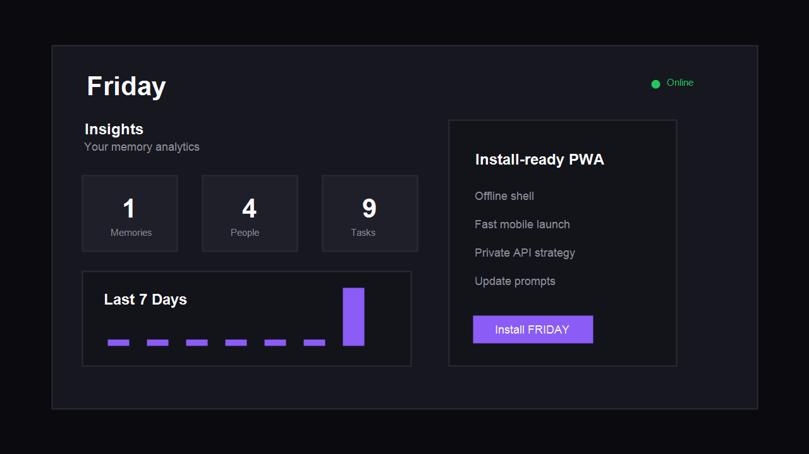

<div align="center">

# FRIDAY

### A private, installable AI memory system with a knowledge graph at its core

Capture thoughts, tasks, people, and health signals. FRIDAY extracts the structure, connects it, and reasons over it.




</div>

---

## Overview

FRIDAY is a single-user personal AI assistant built around a persistent memory layer. Every note you capture is embedded, mined for entities and relationships, and written into a PostgreSQL-backed knowledge graph. A set of focused engines then run over that graph to surface patterns, track decisions, model your behavior, and answer questions with real context.

It ships as a TypeScript monorepo: a **Fastify** API, a **Next.js** installable PWA, and a shared types package.

## Features

- **Memory capture and recall.** Ingest free-form text, then search it with exact, fuzzy (`pg_trgm`), and semantic (`pgvector`) retrieval.
- **Ask FRIDAY.** Natural-language Q&A with knowledge-graph context injected into the prompt.
- **Knowledge graph.** LLM entity extraction, multi-stage duplicate detection and merging, traversal, shortest-path queries, temporal change tracking, and evidence trails.
- **Strategic intelligence.** Daily reflection, weekly digests, strategic reviews, priority and risk engines, and goal alignment scoring.
- **Digital twin and causal reasoning.** Behavioral profile and traits, causal accelerators and blockers, and outcome prediction.
- **Decision engine.** Log decisions, evaluate them later, and see them on a timeline.
- **Google Workspace actions with human approval.** FRIDAY can stage Calendar events, Gmail messages, and Google Tasks. Nothing executes until you approve it.
- **Cost-aware AI gateway.** All LLM calls go through a single router with model tiering, response caching, rate limiting, token budgets, and usage tracking.
- **Installable PWA.** Offline shell, app shortcuts, and update prompts.

## Architecture

```
┌──────────────────────┐        HTTPS + Bearer         ┌─────────────────────────────┐
│  Next.js 15 PWA      │ ────────────────────────────▶ │  Fastify API (Node 22)      │
│  (Vercel)            │                               │  (DigitalOcean + PM2)       │
└──────────────────────┘                               │                             │
                                                       │  Engines · Routes · Workers │
                                                       └───────┬─────────────┬───────┘
                                                               │             │
                                              ┌────────────────▼──┐   ┌──────▼─────────────┐
                                              │ Supabase          │   │ Groq · Embeddings  │
                                              │ Postgres+pgvector │   │ Google Workspace   │
                                              └───────────────────┘   └────────────────────┘
```

### Backend engines

Each engine lives in `backend/src/modules/` with its own types, repository, service, tests, and SQL migrations.

| Engine | Responsibility |
|---|---|
| `knowledge-graph` | Entity extraction, dedup and merge, search, traversal, scoring, snapshots, insights |
| `observation-engine` | Classifies and scores raw signals (manual, git, calendar, health) |
| `activity-engine` | Activity scoring, timelines, and correlation analysis |
| `review-engine` | Strategic reviews, focus, priority, risk, and recommendations |
| `ingestion-engine` | Pluggable source connectors, normalization, and scheduled sync |
| `integration-engine` | Event bus, pipelines, workflows, orchestration, and failure handling |
| `digital-twin` | Behavioral profile, traits, and prediction |
| `causal-engine` / `causal-reasoning` | Causal paths, accelerators, blockers, and prediction |
| `decision-engine` | Decision logging, evaluation, scoring, and timeline |
| `ai-engine` | AI gateway: routing, cache, rate limiter, usage and cost tracking |

### AI model routing

| Tier | Model | Used for |
|---|---|---|
| L1 | `llama-3.1-8b-instant` (Groq) | Fast, cheap tasks such as extraction and classification |
| L2 | `llama-3.3-70b-versatile` (Groq) | Ask FRIDAY, weekly review, strategic review |

Embeddings are pluggable: `openai` (default, `text-embedding-3-small`), `huggingface`, or `ollama`.

### Knowledge graph scoring

```
importance = 0.40 × recency + 0.35 × frequency + 0.25 × connectivity

recency      = e^(-λ·t)                    λ = ln(2) / 30 days
frequency    = log(min(count, 100)) / log(100)
connectivity = (edge_count / 50) × avg_edge_strength
```

Duplicate detection runs exact, normalized, alias, and semantic matching. Matches at or above `0.95` merge automatically; lower-confidence matches are flagged for review. See [`backend/src/modules/knowledge-graph/README.md`](backend/src/modules/knowledge-graph/README.md) for details.

## Tech stack

| Layer | Technology |
|---|---|
| Frontend | Next.js 15, React 19, Tailwind CSS 4, Framer Motion, Radix UI, Lucide |
| Backend | Fastify 5, TypeScript, Zod, node-cron, Helmet, CORS |
| Data | Supabase (PostgreSQL, `pgvector`, `pg_trgm`) |
| AI | Groq SDK, OpenAI / Hugging Face / Ollama embeddings |
| Integrations | Google APIs (Calendar, Gmail, Tasks) via OAuth 2.0 |
| Ops | Docker, PM2, Nginx, Vercel, DigitalOcean |
| Testing | Vitest |

## Repository structure

```
.
├── backend/                  # Fastify API
│   ├── src/
│   │   ├── lib/              # Supabase, Groq, embeddings, Google token helpers
│   │   ├── middleware/       # Bearer-token auth
│   │   ├── modules/          # Engines (see table above)
│   │   ├── routes/           # HTTP routes
│   │   ├── workers/          # reflect + digest cron workers
│   │   └── server.ts
│   ├── Dockerfile
│   └── ecosystem.config.js   # PM2: API cluster + cron workers
├── frontend/                 # Next.js PWA
│   ├── app/                  # App Router, API proxy, offline page
│   ├── components/           # Memory UI, PWA lifecycle, UI primitives
│   └── public/               # Manifest, icons, service worker
├── shared/                   # @friday/shared: types and utilities
├── docker-compose.yml
├── DEPLOYMENT.md             # Production runbook
└── MIGRATION_CHECKLIST.md
```

## Getting started

### Prerequisites

- Node.js 22+
- A [Supabase](https://supabase.com) project with the `vector` and `pg_trgm` extensions enabled
- A [Groq](https://console.groq.com) API key
- An OpenAI API key (or configure Hugging Face / Ollama for embeddings)
- *(Optional)* Google Cloud OAuth credentials for Workspace actions

### 1. Clone and install

```bash
git clone https://github.com/<your-username>/friday.git
cd friday
npm install
```

### 2. Configure the environment

```bash
cp .env.local.example .env.local
```

Fill in the values. Generate a strong API secret with:

```bash
node -e "console.log(require('crypto').randomBytes(32).toString('hex'))"
```

<details>
<summary><strong>Environment variables</strong></summary>

**Backend**

| Variable | Description |
|---|---|
| `PORT`, `HOST`, `NODE_ENV` | Server settings (default `3001`) |
| `ALLOWED_ORIGIN` | Comma-separated CORS origins |
| `FRONTEND_URL` | Frontend URL, used as the OAuth redirect destination |
| `FRIDAY_API_SECRET` | Bearer secret; must match the frontend value |
| `FRIDAY_USER_ID` | Single-user UUID |
| `SUPABASE_URL`, `SUPABASE_SERVICE_ROLE_KEY` | Supabase project (service role is server-side only) |
| `GROQ_API_KEY` | LLM provider |
| `EMBEDDING_PROVIDER` | `openai` \| `huggingface` \| `ollama` |
| `OPENAI_API_KEY`, `OPENAI_EMBEDDING_MODEL` | OpenAI embeddings |
| `GOOGLE_CLIENT_ID`, `GOOGLE_CLIENT_SECRET`, `GOOGLE_REDIRECT_URI` | Google OAuth |
| `REFLECT_HOURS_BACK` | Lookback window for the reflection worker (default `24`) |

**Frontend**

| Variable | Description |
|---|---|
| `NEXT_PUBLIC_SUPABASE_URL`, `NEXT_PUBLIC_SUPABASE_ANON_KEY` | Supabase public config |
| `NEXT_PUBLIC_APP_PASSWORD` | App lock-screen password |
| `NEXT_PUBLIC_FRIDAY_API_URL` | Backend base URL |
| `NEXT_PUBLIC_FRIDAY_API_SECRET` | Must match `FRIDAY_API_SECRET` |

</details>

### 3. Set up the database

Run the SQL against your Supabase project in this order:

1. `backend/src/modules/knowledge-graph/schema.sql`
2. The numbered migrations in each module's `migrations/` folder, and the shared files in `backend/src/modules/migrations/`

### 4. Run it

```bash
npm run build:shared      # build @friday/shared first
npm run dev:backend       # API on http://localhost:3001
npm run dev:frontend      # app on http://localhost:3000
```

Or run the backend with Docker:

```bash
npm run docker:up
```

Verify the API is up:

```bash
curl http://localhost:3001/healthz
# {"ok":true,"ts":"...","env":"development"}
```

## API

All routes except `/healthz` and `/google/callback` require `Authorization: Bearer <FRIDAY_API_SECRET>`.

| Area | Endpoints |
|---|---|
| Memory | `/ingest`, `/memory/ask`, `/memory/search`, `/memory/reflect`, `/weekly-summary` |
| Graph | `/graph/path`, `/graph/analytics`, `/graph/export`, `/graph/temporal/changes`, plus profile, evidence, and planner |
| People and tasks | `/people`, `/todos`, `/tasks` |
| Google actions | `/google/connect`, `/google/status`, `/commands/pending` |
| Intelligence | `/review/latest`, `/review/generate`, `/twin/profile`, `/twin/traits`, `/twin/predict`, `/twin/rebuild` |
| Causal and decisions | `/causal/patterns`, `/causal/accelerators`, `/causal/blockers`, `/causal/predict`, `/decisions`, `/decisions/:id/evaluate` |
| Activity and signals | `/activities`, `/activities/timeline`, `/observation/recent`, `/health`, `/health/analyze` |
| Ingestion | `/ingestion/source`, `/ingestion/sync`, `/ingestion/history`, `/ingestion/health` |

### Approval flow for Google actions

```
pending ──▶ approved ──▶ executed
   │                        │
   └──▶ denied              └──▶ failed
```

Supported tools: `calendar_insert`, `gmail_send`, `tasks_insert`.

## Background workers

| Worker | Schedule (server time) | Purpose |
|---|---|---|
| `friday-reflect-cron` | Daily at 03:00 | Reflects on recent memories and updates the graph |
| `friday-digest-cron` | Mondays at 08:00 | Generates the weekly digest |

Run either manually for testing:

```bash
cd backend
npx tsx src/workers/reflect.worker.ts
npx tsx src/workers/digest.worker.ts
```

## Testing

```bash
cd backend
npm test            # vitest run
npm run test:watch
```

The suite covers the knowledge graph, strategic intelligence, observation, activity, review, ingestion, integration, digital twin, and causal reasoning engines.

## Deployment

Production runs as a split deployment: **frontend on Vercel**, **backend on a DigitalOcean Droplet** (Ubuntu 24.04, PM2, Nginx, Let's Encrypt), and **Supabase** for data.

The full runbook, including firewall rules, the Nginx config, the Google OAuth redirect update, smoke tests, zero-downtime reloads, and rollback, is in [`DEPLOYMENT.md`](DEPLOYMENT.md).

```bash
# Deploy an update
cd /opt/friday && git pull && npm run build
cd backend && pm2 reload friday-api
```

## Security notes

- The backend uses the Supabase **service role** key. Keep it server-side and never expose it to the browser.
- Never commit `.env.local`. Rotate any key that has been exposed.
- `NEXT_PUBLIC_*` variables are bundled into the client. The frontend password gate and `NEXT_PUBLIC_FRIDAY_API_SECRET` are suitable for a personal, single-user deployment, but not for a multi-user product. Moving to per-user authentication (for example Supabase Auth with JWT verification) is the right next step before opening this up.
- Do not expose port `3001` publicly. Put the API behind a TLS-terminating reverse proxy.
- Google-initiated actions require explicit approval before they execute.

## Roadmap

See [`backend/HARDENING_ROADMAP.md`](backend/HARDENING_ROADMAP.md) for the engine-by-engine audit and open items. Highlights:

- [ ] Wire the knowledge graph fully into the ingestion pipeline and weekly digest
- [ ] Route every LLM call through the AI gateway
- [ ] Paginate graph snapshots and bound edge lookups for large graphs
- [ ] Redis caching for hot neighborhoods and a background score-refresh queue
- [ ] MCP tool surface (`searchGraph`, `getNodeNeighborhood`, `generateInsights`)
- [ ] Per-user authentication

## Contributing

Issues and pull requests are welcome. For larger changes, please open an issue first to discuss the approach, and include tests for new engine logic.

## License

Released under the [MIT License](LICENSE).

---

<div align="center">
Built by <a href="https://github.com/<your-username>">Khan</a>
</div>
